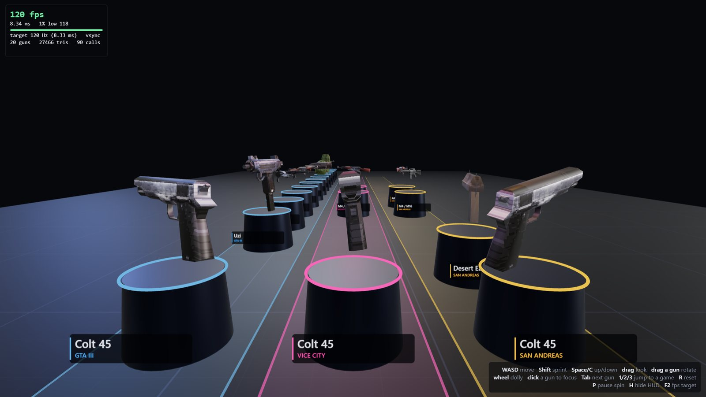

# GTA PS2 Model Viewer

Extract the weapon models from your own PlayStation 2 discs of Grand Theft Auto III, Vice City and San Andreas,
then look at them in a 120 Hz viewer that is also a scriptable capture rig.

- `tools/extract.py` reads the disc images and writes OBJ + PNG for 20 weapons.
- The viewer (Electron + three.js) stands every gun on a pedestal in one hall: one lane per game, one column per weapon, so the same gun lines up across games. Guns spin slowly; you can walk around and drag them.
- Captures are deterministic: a JSON file describes camera moves and captions, and the viewer renders it headlessly to MP4 through ffmpeg.

Clips are in [`site/media`](site/media). The landing page source is in [`site`](site).



## What you need

- A copy of each PS2 game you want, as an ISO. **No game files, models or textures are included in this repository.**
- Windows 10/11 (written and tested there; the extractor is plain Python and should also run on Linux or macOS with a C++ compiler, which is untested).
- [Node.js](https://nodejs.org) 22 or newer, [Python](https://python.org) 3.9 or newer, [git](https://git-scm.com), and a C++ compiler on `PATH` (`g++` from [MSYS2](https://www.msys2.org) or MinGW-w64).
- [ffmpeg](https://ffmpeg.org) on `PATH`, only for video capture.

## Set up

```
git clone https://github.com/devin-thomas/gta-ps2-model-viewer
cd gta-ps2-model-viewer
npm install
python tools/extract.py --gta3 "GTA III.iso" --vc "Vice City.iso" --sa "San Andreas.iso"
```

Any subset of the three games works. The first extraction clones and builds
[aap/librw and aap/librwgta](https://github.com/aap/librwgta) (pinned commits) into `work/`, which takes about a minute;
the whole run took 34 s on the author's machine. Models land in `models/`.
Details and file locations: [docs/EXTRACTION.md](docs/EXTRACTION.md).

## Run

Double-click **`Gun Viewer.cmd`** (it also installs Electron on first run), or:

```
npm start
```

| Input | Action |
|---|---|
| WASD / arrows, Shift, Space, C | walk, sprint, up, down |
| drag the background | look |
| drag a gun | rotate it; it keeps its momentum, then returns to the slow spin |
| click a gun, Tab / Shift+Tab | glide the camera to it |
| mouse wheel | dolly |
| 1 / 2 / 3 | jump to the GTA III / Vice City / San Andreas lane |
| P, H, R, F2 | pause spin, hide HUD, reset view, switch HUD target between 120 and 60 |

More in [docs/VIEWER.md](docs/VIEWER.md).

## Capture video

```
npm run capture:tour                       # shots/tour.json -> out/tour.mp4 (120 fps)
npm run capture:lineup
npx electron . --capture shots/tour.json --out out/tour60.mp4 --fps 60 --crf 20
```

Capture opens no window. A 25 s, 1080p, 120 fps clip takes about two minutes. The shot format and the live control port
(`--control-port`, with `GET /state`, `GET /screenshot`, `POST /cmd`) are in [docs/SCRIPTING.md](docs/SCRIPTING.md).

## Performance

Everything is a function of scene time, so frame pacing never changes what you see. The window paints at display refresh;
`--uncapped` removes the limiter for benchmarking (`npm run bench`). On an RTX 4090 at 2002×1127 with about 27 000 triangles
and 90 draw calls the viewer averaged 119.6 fps with 99.9% of frames inside the 120 Hz budget (1% low 117.6 fps).
The uncapped figure of roughly 3 600 fps measures CPU submission only, not completed GPU work.

## Status and limits

- Extracted: GTA III (all 14 weapon models in `WEAPONS.DFF`), Vice City (Colt 45, AK-47, M4), San Andreas (Colt 45, AK-47, M4, Desert Eagle). `--add sa:chromegun`-style flags pull more from the Vice City and San Andreas archives.
- Not done: Liberty City Stories and Vice City Stories (their own model formats), Xbox and PC versions, vehicles, pedestrians and anything skinned.
- Models are exported as plain OBJ; vertex colours are not exported, so guns look flatter than in game.
- Only tested against: GTA III (USA, SLUS_200.62), Vice City (USA v1.40), San Andreas (USA v1.03).

## Credits

[librw and librwgta](https://github.com/aap/librwgta) by aap (PS2 geometry and texture conversion),
[three.js](https://threejs.org), [Electron](https://www.electronjs.org). The RenderWare formats are documented by the
[GTAMods wiki](https://gtamods.com/wiki/RenderWare).

## Legal

Unofficial. Not affiliated with or endorsed by Rockstar Games or Take-Two Interactive. Grand Theft Auto and the game
assets belong to their owners. Use your own discs. The clips in `site/media` are short renders of models extracted from
the author's own copies, shown for documentation.

Code is MIT licensed, see [LICENSE](LICENSE).
